<h1 align="center">🎬 Vavoo Stream Live</h1>

<p align="center">
  <a href="https://github.com/Belfagor2005/vavoo">
    
  </a>

  <a href="https://www.enigma2.net">
    
  </a>

  <a href="https://python.org">
    
  </a>

  <a href="https://creativecommons.org/licenses/by-nc-sa/4.0/">
    
  </a>

  <a href="https://github.com/Belfagor2005/vavoo/actions/workflows/pylint.yml">
    
  </a>

</p>

<p align="center">
  <a href="https://github.com/Belfagor2005">
    
  </a>
</p>

<p align="center">
  <a href="https://ko-fi.com/lululla">
    
  </a>

  <a href="https://paypal.me/belfagor2005">
    
  </a>
</p>

## 📌 Overview
Vavoo Stream Live Plugin is an Enigma2 extension that provides access to thousands of live TV channels from multiple countries. It features a built-in local proxy that keeps streams stable, a choice of stream source per channel, automatic bouquet updates, EPG integration, real-time notifications, and seamless integration with your Enigma2 receiver.

## 🖼️ Screenshots

The Full HD skins of this version, drawn with sample channels.

| | |
|---|---|
| 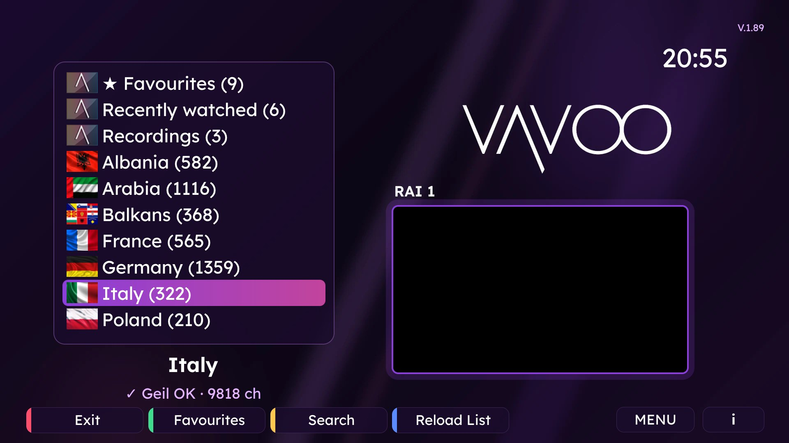<br>**Main menu** (Prism) – Favourites, Recently watched and Recordings above the countries; the preview window | 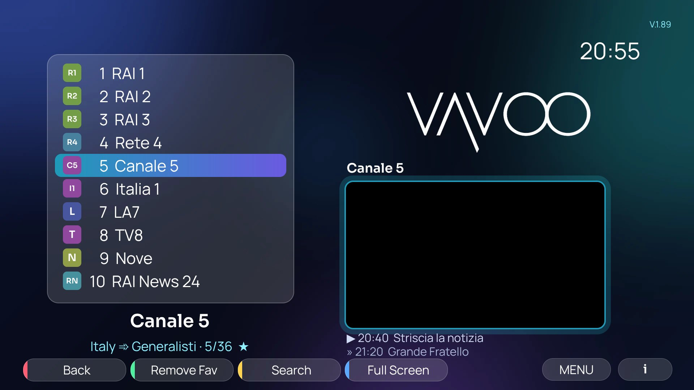<br>**Channel list** (Halo) – numbered like a receiver's list, initials tiles, now / next under the preview |
| 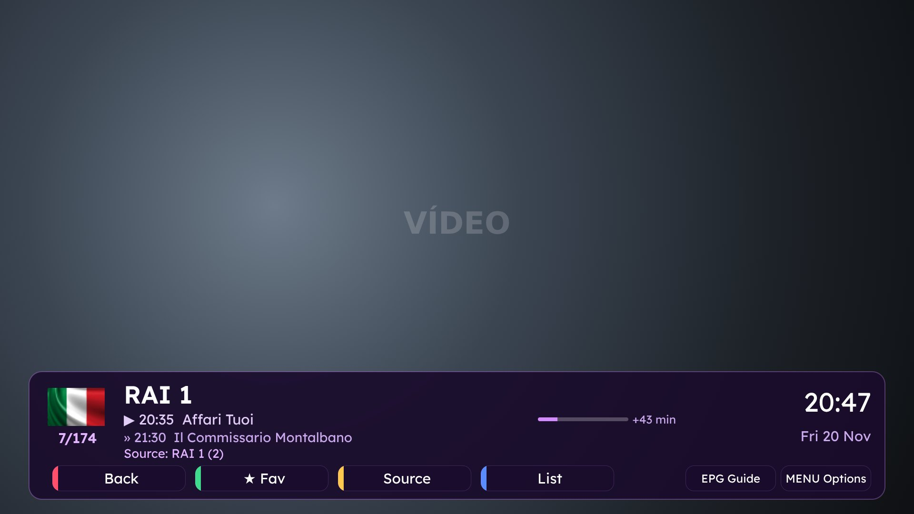<br>**Player** (Prism) – the info bar: programme now and next, time left, source, clock and date, one row of keys | 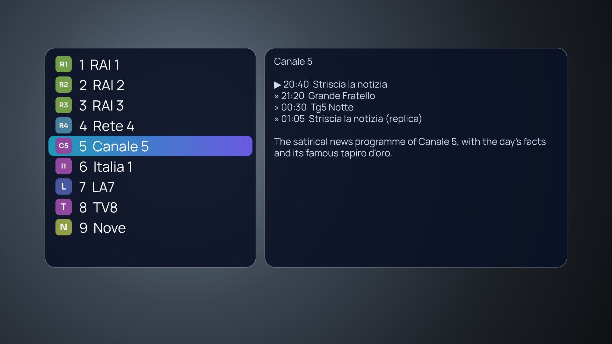<br>**Channel list over the video** (Halo, BLUE in the player) – with the mini guide |
| 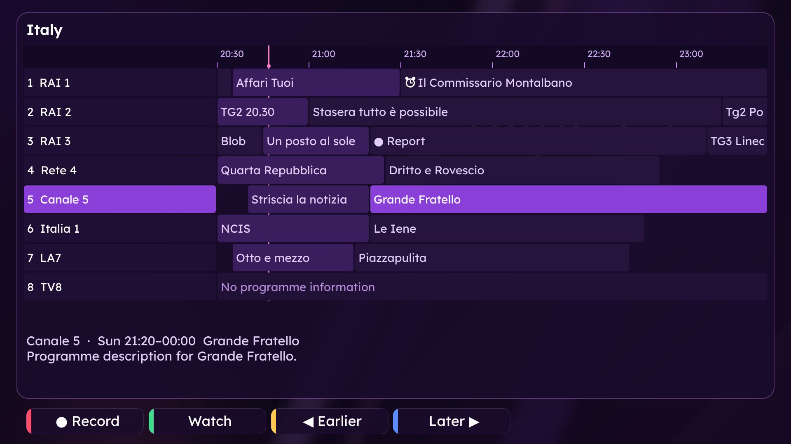<br>**Programme guide** (Prism) – ● recording set, ⏰ reminder; RED records the highlighted programme | 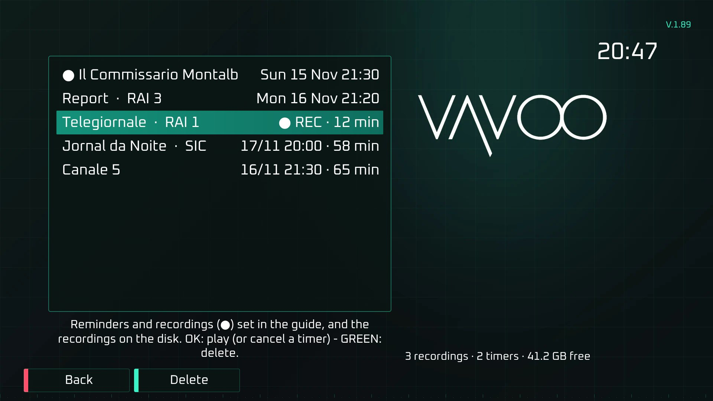<br>**Recordings** (Orbit) – timers set in the guide, a recording in progress, the recordings on the disk |
| 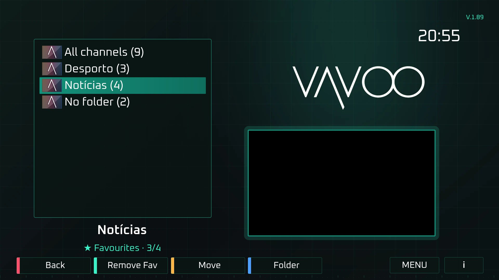<br>**Favourites** (Orbit) – in your own folders and order | 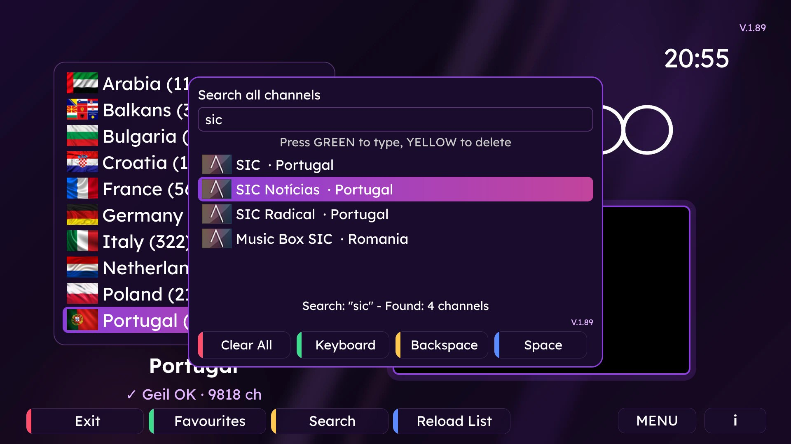<br>**Search all channels** (Prism) – each result with its country |
| 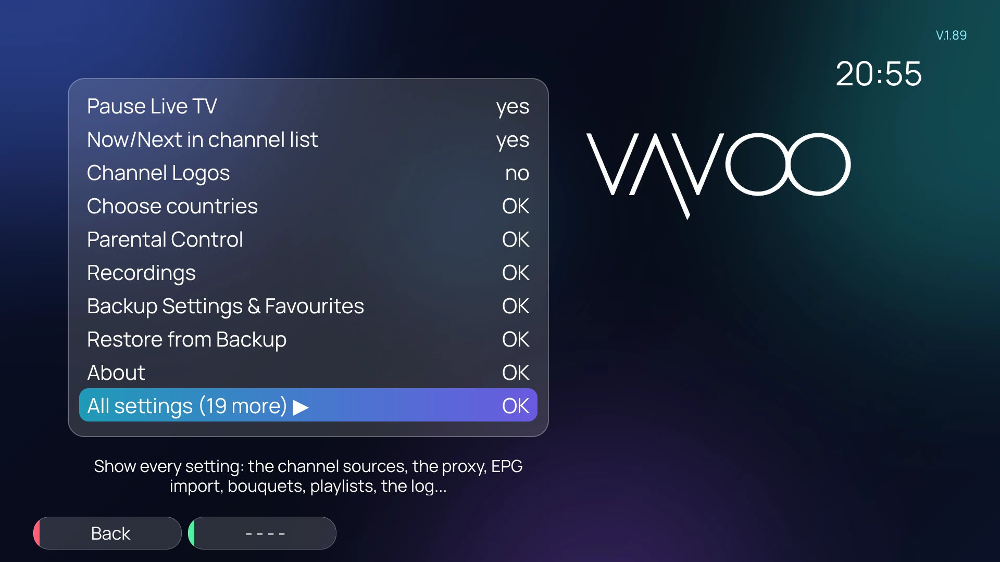<br>**Settings** (Halo) – the options most people change; "All settings ▶" shows the rest | 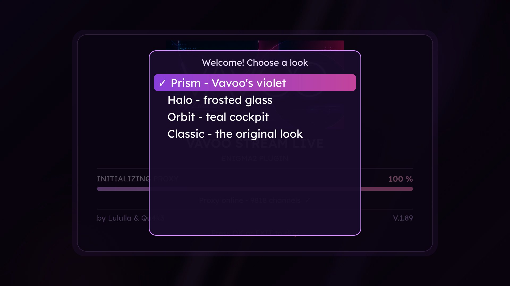<br>**Welcome** (Prism) – a new install's first opening: the look, then your countries and a PIN |
| 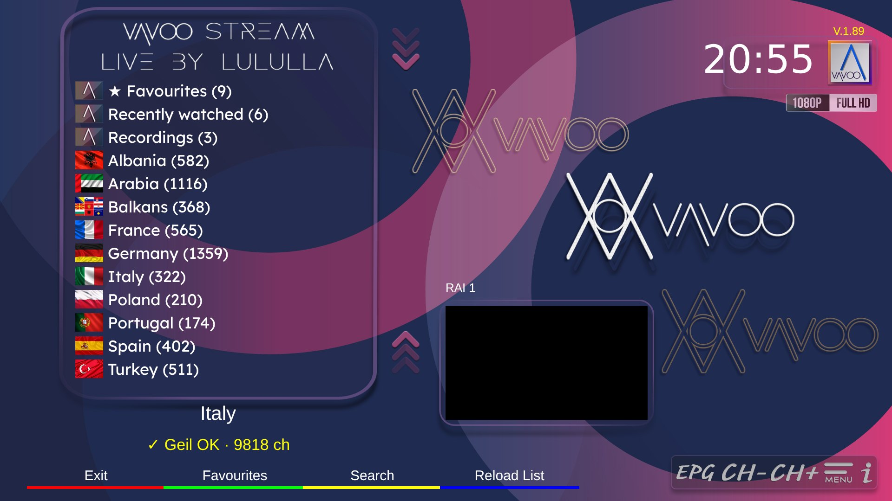<br>**Classic** – the plugin's original look | |

## ✨ Key Features

### Watching
- **Looks Like the Android App** – The themes of the companion Android app: **Prism** (Vavoo's violet, the default), **Halo** (frosted glass over a blue aurora) and **Orbit** (a teal cockpit display), each with its own background, fonts, rounded panels, colour keys and preview frame, in large or normal text. **Classic** keeps the plugin's original look and backgrounds (see "Themes" below)
- **Live TV Streaming** – Thousands of live channels, browsed by country, with country flags; channels numbered like a receiver's list (the number keys go to that row)
- **Opens at Once** – The plugin starts with the channel list it loaded last time (kept in `/etc/enigma2`, up to 3 days old) and fetches the new one behind it: no waiting for the catalog after a reboot. The counts update by themselves when the new list is in
- **Fast Zapping** – 3 seconds after you change channel, the next one in the same direction is already prepared, so the next CH+ / CH- starts sooner (Geil source)
- **Channel Logos or Initials** – As in the app: each channel's initials on a tile of its own colour ("RAI 1" → "R1"), or its logo with the setting "Channel Logos". Logos are kept on a USB stick, SD card or SSD when the box has one (they stay after a reboot and use no memory), else in memory, kept small
- **Sub-categories** – A country whose channels come in categories (Sport, News...) lists "All channels", the categories and "General" first
- **Choose Countries** – Hide the countries you never watch from the main list and from search
- **Stable Streams** – The local proxy keeps one stream address for the whole viewing. When a stream fails it is retried with a fresh address, and if it fails again the plugin moves to another source of the same channel by itself
- **Preview Window** – As in the app: OK on a channel plays it in the small window beside the list; OK again on it (or BLUE) opens it full screen with the same stream, no restart. Closing full screen leaves it playing in the window; leaving the plugin brings back the TV channel you were watching before
- **App-style Player** – In the themes, the app's info bar: logo or flag, channel number ("7/174"), name, programme now with a progress bar and the minutes left, the next programme, the source in use, the clock and date and one row of keys. BLUE opens the channel list over the video with a **mini guide** (now, the next three, the description), YELLOW the source, EPG the guide; type a channel number to go there; 0 (or RECALL) goes back to the previous channel
- **Player Options** – MENU in the player: favourite, audio track, subtitles, stream source, aspect ratio, sleep timer (the box goes to standby), record, stream info (resolution, frame rate, codec, source), programme guide and IMDb/TMDB
- **Recently Watched** – The last 20 channels you watched, in the main list; optionally start the plugin on the last one
- **Choose Your Source** – A channel available from several sources is shown as one row (setting "Group Sources"). Pick the source in the player (MENU → Source) by its own name (for example "SIC .b", "SIC HD .s"). The pick is remembered. Exported bouquets list every source as its own channel, under its own name
- **Programme Guide** – As in the app: INFO (or EPG) in a channel list, Favourites or Recently watched, or MENU → "Programme guide" in the player, shows a grid of those channels with three hours across - a box per programme, the now line, what is on now in its own colour. Look back 3 hours or ahead to the end of the guide (about a day)
- **Reminders** – OK on a programme still to come → "Remind me": at its start a window offers to watch it, also with the plugin closed
- **Recordings** – As in the app: record the channel you watch (MENU → Record, or REC) until the programme's end, or set a recording in the guide. It goes on when you zap, close the plugin or put the box in standby, and the box wakes from deep standby for one set in the guide. Recordings go to Enigma2's movie folder (they show in the box's own movie list too) and play from the "Recordings" list
- **Pause Live TV** – PAUSE in the player records the channel on the disk; PLAY goes on from where you paused, LEFT / RIGHT move back and forth, EXIT returns to live (up to 2 hours)
- **Now / Next Beside the List** – While you browse a country (or your Favourites), the area by the preview window shows what is on the highlighted channel now and what comes next, on your box's clock (in the themes, as the app writes it: "▶ 20:00  Jornal da Noite" / "» 21:30  Linha Aberta"). No export or EPGImport needed. The guides of your favourites' countries are loaded in the background shortly after the plugin opens, so they show at once
- **Search** – As in the app: the words in any order, accents and case do not count, "1" finds "SPORT 1" but not "SPORT 11"; from 3 letters also the channels whose programme on now has the text. Inside a country (YELLOW in the channel list) or in every country at once (YELLOW in the main menu - each result shows its country). The results become the player's list
- **Favourites** – GREEN adds or removes the highlighted channel while browsing; GREEN in the main menu, or the "★ Favourites" row at the top of it, opens them. Put them in your own order (YELLOW Move) and in folders (BLUE Folder), as in the app; they show under a title per country (Portugal, then its channels, then Italy...). Kept in `/etc/enigma2`, so a plugin update keeps them
- **Parental Control** – A 4-digit PIN for adult channels, chosen countries and (optionally) the settings; once entered, all is open for 15 minutes
- **Backup / Restore** – The settings, favourites (with folders and order), recently watched, sources and countries in one file on your disk
- **Simple Settings** – Settings open with the 14 options most people change; "All settings ▶" at the end shows the rest
- **Welcome** – On a new install, the first opening asks for the look, your countries and (if you want) a PIN for adult channels

### In your Enigma2 channel list
- **Enigma2 Bouquet Export** – Export a country's channels straight into your channel list, at the top or the bottom - every source of a channel ("SIC .b", "SIC .c", "SIC .d") as its own channel
- **Favourites Bouquet** – Your favourites as one bouquet, "Vavoo ★ Favourites": a title per country with its channels under it, kept the same as the Favourites list
- **Scheduled Updates** – Re-match EPG and refresh the exported bouquets at an interval or at a fixed time of day
- **EPG Integration** – Electronic Program Guide for supported channels, in the plugin and through EPGImport: epgshare01's daily files, the GitHub copy as a fallback
- **M3U Playlist Generation** – Create standard M3U playlist files for external players
- **Live Playlist Server** – `/playlist.m3u` always reflects the current catalog, no manual regeneration needed; optional access key

### Under the hood
- **Local Proxy** – Always on, handles the authentication tokens (no 10-minute blocks), with its status shown in the main screens ("✓ Geil OK · 9818 ch"; "Loading channels..." while it starts). The screens read it directly - it runs inside the plugin - so they never wait on it
- **Two Catalog Sources** – Geil (default, needs no token) with automatic fallback to Vavoo/Kool, or pin one of them in the settings
- **Mirror Fallback** – Automatic switch to a mirror when a site answers HTTP 451 or is unreachable
- **Real-time Notifications** – A bar at the top of the screen for exports, EPG processing and errors, on any screen resolution
- **Update Check** – On start the plugin checks this repository (OwnerPlugins/vavoo, branch `main`) for a newer version and shows its changelog; one key press installs it
- **In-UI Log Viewer** – "Show Log" in Config shows the last 200 lines of `vavoo.log`; "Debug logging" adds detail when troubleshooting
- **Cache Format Fix** – MENU → "Fix EPG cache" in the main menu cleans up the EPG match cache
- **Multi-Language** – Translated into 90+ languages
- **Custom Backgrounds** – Selectable background image (Classic theme)
- **Anonymous Statistics** – Opt-out, no personal data (see Privacy below)

## 🎮 Remote Control Keys

The colour keys are the Android app's, in every theme. The Enigma2 tools that used to sit on them (bouquets, EPG cache) are in the **MENU** key's list.

The remote's own keys go straight to their function, in every list and on every image (the plugin's key map, `keymap.xml`): **FAV** the favourites, **PVR / FILE / VIDEO / LIST** the recordings, **TEXT** search, **PLAY** full screen, **STOP** stops the preview window, **REC** records the highlighted channel, **0** the channel watched last, **BACK** as EXIT. **HELP** shows the keys of the screen you are in and what they do - in every screen of the plugin.

### Main menu (country list)
| Key | Action |
|-----|--------|
| OK | Open the selected country (or the "★ Favourites" row) |
| GREEN | Favourites |
| YELLOW | Search all channels, in every country |
| BLUE | Reload List: download the channel list again (asks first; the proxy restarts and waits for the new list, a channel playing stops for a moment) |
| MENU | Settings, Reload bouquets, Remove all Vavoo bouquets, Import EPG now, Fix EPG cache, Refresh token, Show Log, Factory reset, About |
| INFO | Version, channels and countries (hold INFO: About) |
| EPG | The programme guide of your favourites (the EPG import is in MENU → Import EPG now) |
| FAV | Favourites |
| PVR / FILE | Recordings |
| TEXT | Search all channels |
| 0 | The channel watched last, full screen |
| PLAY / STOP / REC | The channel in the preview window: full screen / stop / record |
| HELP | The keys of this screen |
| CH+ / CH- | Page up / down |
| RED / EXIT / BACK | Quit |

The list starts with "★ Favourites (n)" once you have favourites, then "Recently watched (n)", and shows each country's channel count ("Portugal (174)", setting "Show Counts"). Countries hidden in Settings → Choose countries are left out; a country locked by Parental Control has a padlock. The line under the name shows the source and the channels, as in the app: "✓ Geil OK · 9818 ch". On a new install the welcome (the look, your countries, a PIN) comes before the list, once.

### Channel list
| Key | Action |
|-----|--------|
| OK | Play the channel in the preview window; OK again on it: full screen (setting "Preview Window"; off: full screen at once). On a category row: open it |
| BLUE (Full Screen) | Full screen at once |
| GREEN | Add Fav / Remove Fav (the caption follows the highlighted channel) |
| YELLOW | Search this country (also from inside a category: the whole country) |
| 0-9 | Go to that channel number (typed within 1.5 s the digits add up: 1, 2 = 12) |
| MENU | Settings, Export this country as a bouquet (or Remove this country's bouquet), Reload bouquets, Show Log |
| INFO / EPG | The programme guide of this list, from the highlighted channel (on category rows: version and channels) |
| PLAY | Full screen at once |
| REC | Record the highlighted channel (again: stop) |
| STOP | Stop the preview window |
| TEXT | Search this country |
| FAV / PVR | Favourites / Recordings |
| 0 | The channel watched last (as the first number; 1, 0 is row 10) |
| HELP | The keys of this screen |
| CH+ / CH- | Page up / down |
| RED / EXIT / BACK | Back |

With "Sub-categories" on, a country whose catalog has two or more categories first lists "All channels (n)", its categories A-Z and "General (n)"; OK opens one ("Italy ➾ Sport"). The line under the channel name shows where you are, as in the app: "Portugal · 7/174", with "★" when the highlighted channel is a favourite. Next to the preview window the list shows the highlighted channel's current and next programme. It fills in a moment after the highlight stops moving; the first time in a country it says "Loading programme guide..." for a few seconds.

### Player
The same keys in every theme, Classic included - each function has a key of its own on the remote (no moving along the bar with the arrows). The themes' bar is laid out like a receiver's info bar: the information, the clock and the date, and one row of captions ("Back · ★ Fav · Source · List", "EPG Guide · MENU Options" - AUDIO and 0 Recall work as well, HELP lists them); Classic keeps Enigma2's own bar and lists them in its top line.

The keys are also the same on every image (OpenATV, OpenPLi, OpenViX, ...): the plugin brings its own key map (`keymap.xml`, loaded when Enigma2 starts), because the images name the same key differently - on OpenATV 7, MENU in a player opened Enigma2's main menu, and PAUSE / PLAY did nothing on a live channel. Each key does one thing, once (pressing, releasing or holding it never sets off something else).

| Key | Action |
|-----|--------|
| OK | Show / hide the bar (Classic: the infobar and the top line). Paused: play on. While typing a channel number: go there |
| CH+ / CH- or UP / DOWN | Next / previous channel |
| LEFT / RIGHT | Behind live (Pause Live TV): 10 seconds back / on. Live: nothing to move |
| RED / EXIT / BACK | Back: close the player (with the preview window on, the channel keeps playing in it). Paused or behind live: back to live first |
| GREEN | Add / remove the channel as a favourite (★ / ☆ on the bar) |
| YELLOW | Source: pick the source of a channel that has several ("Only one source available for this channel" otherwise) |
| BLUE | The channel list over the video, with the mini guide of the highlighted channel (OK plays it, GREEN adds / removes a favourite, RED / EXIT closes it) |
| EPG / INFO | The programme guide over the video (as INFO / EPG in the channel lists) |
| MENU | Options: favourite, audio track, subtitles, source, aspect ratio, sleep timer, Record ("Record: ● 12:34" while recording - again: stop), stream info, programme guide, IMDb / TMDB |
| AUDIO / SUBTITLE | Audio track / subtitles (Enigma2's own) |
| 1-9 | Go to that channel number ("12-" and "→ name" show while you type; it goes after 1.5 s, on OK, or at once when no larger number exists) |
| 0 or RECALL | The channel watched before |
| REC | Record this channel until the end of the programme on now plus 2 minutes (no guide, or it ends within 10 minutes: until stopped, 4 hours at most); again: stop. "● REC" shows on the bar |
| PAUSE, PLAY or PLAY/PAUSE | Pause Live TV (see below): pause; again: play on |
| << / >> | Behind live: 30 seconds back / on |
| FAV | The favourites over the video (as BLUE's list); the one chosen plays |
| HELP | The keys of the player |
| STOP | Close the player |

**Pause Live TV** (Settings → "Pause Live TV", as in the app): PAUSE stops the picture and starts recording the channel on the disk ("❚❚ Paused · recording - press play to go on"). PLAY (or OK) goes on from there, behind live ("◀◀ -1:23  LEFT / RIGHT move · EXIT: live" in the bar):

| Key (behind live) | Action |
|-----|--------|
| LEFT / RIGHT | 10 seconds back / on (never past live) |
| << / >> | 30 seconds back / on |
| PAUSE / PLAY | Pause there / play on |
| RED / EXIT | Back to live ("Live"); the recorded part is deleted |
| CH+ / CH- / UP / DOWN | Zap as usual (the recorded part is deleted) |

Each move opens the recorded part again at that place, which takes the box's player a moment (one to three seconds). It keeps up to 2 hours, in Enigma2's timeshift folder, else the recordings folder, else the disk under `/media` with the most room (a USB stick at `/media/usb` too - Enigma2's own folders are both on `/media/hdd` unless changed), with at least 400 MB free; never a network share.

Without a disk or `ffmpeg`, PAUSE only pauses and says so ("❚❚ Paused · not recorded (no disk) - PLAY returns to live"): the box's player then goes on with the live stream, and after a longer pause that is live itself. If the recording stops while paused (the stream refused, the disk full), PLAY still plays what it recorded and then goes back to live; with nothing recorded, "not recorded (the stream could not be recorded)". `/tmp/vavoo.log` has a `[Pause]` line for each step (recording to..., not recorded: ..., buffer stopped..., playing the buffer from -m:ss, end of the buffer - live).

### Search
| Key | Action |
|-----|--------|
| Number keys | Type |
| GREEN | On-screen keyboard |
| YELLOW | Backspace |
| BLUE | Space |
| RED | Clear all |
| OK | Play the selected result - the results are the player's list (CH± goes along them) |
| TEXT | On-screen keyboard |
| HELP | The keys of this screen |

Every word typed has to be at the start of a word of the name, or (3 letters or more) anywhere in it; accents and case do not count, and a number must be a whole number ("1" finds "SPORT 1" and "SPORT1", not "SPORT 11"). Names starting with the first word come first. From 3 letters the channels whose programme on now has the text follow, marked "▶ title" (only countries whose guide is already loaded). Rows show "★" on favourites and, searching every country, the country.

### Favourites
| Key | Action |
|-----|--------|
| OK | Preview window, then full screen (as in the channel list). On a folder row: open the folder. While moving: Done |
| GREEN | Remove Fav (the next channel takes its place) |
| YELLOW | Move / Done: move the highlighted channel - UP / DOWN one place, LEFT / RIGHT or CH± a page, a number to that place, within its country; OK, YELLOW or EXIT finish (saved once, at the end) |
| BLUE | Folder: on a channel, "Folder for X" (the folders, No folder, New folder…); on a folder row, Rename folder (another folder's name merges the two) / Remove folder (its channels stay favourites) |
| 1-9 | Go to that channel |
| 0 | The channel watched last |
| MENU | Settings, Move this country (UP / DOWN move the highlighted channel's whole country; OK, YELLOW or EXIT finish), Export favourites as a bouquet (once exported: Update the favourites bouquet, Remove the favourites bouquet), Show Log |
| INFO / EPG | The programme guide of these channels (on folder rows: version and number of channels) |
| PLAY / REC / STOP | Full screen / record the highlighted channel / stop the preview window |
| TEXT / PVR | Search / Recordings |
| HELP | The keys of this screen (while moving: the Move keys) |
| RED / EXIT / BACK | Back |

Once a favourite is in a folder, the Favourites open on "All channels (n)", the folders A-Z and "No folder (n)". A folder with no channels left is gone. Moving inside a folder only swaps that folder's channels.

With "Favourites by country" (on), the channels show under a title per country - its flag and name - in the order of each country's first favourite; UP / DOWN step over the titles, the numbers count channels only, and the player zaps through the channels in that order.

### Recently watched
| Key | Action |
|-----|--------|
| OK | Preview window, then full screen |
| GREEN | Add Fav / Remove Fav |
| YELLOW | Search this list |
| BLUE | Full screen at once |
| INFO / EPG | The programme guide of this list |
| MENU | Settings, Clear recently watched, Show Log |
| PLAY / REC / STOP, TEXT, PVR, 0, HELP | As in Favourites |
| RED / EXIT / BACK | Back |

### Programme guide
The app's grid: the channels of the list it was opened from (numbered, in the same order, from the highlighted one), three hours across, a box per programme with its title - the one on now in its own colour, the highlighted one in the theme's colour, a clock mark where a reminder is set, "● " before the title of one set to be recorded (or being recorded). The ruler shows the half hours (the weekday at midnight) and the now line, which moves every minute. Under the grid: "Channel · 20:00–21:00 Title" and the description; with the preview window on, it keeps playing in the corner. A channel with nothing in those hours says "No programme information" ("Loading…" while its guide comes); a locked channel shows only a padlock.

| Key | Action |
|-----|--------|
| UP / DOWN | Previous / next channel (round the ends) |
| CH+ / CH- | A page of channels (over the player: change the channel playing, the grid follows) |
| LEFT / RIGHT | Previous / next programme (none left: the window moves half an hour) |
| YELLOW / BLUE | An hour back / on (from 3 hours back to the end of the guide, about a day ahead) |
| INFO / EPG / 0 | Back to now |
| 1-9 | Go to that channel (typed within 1.5 s the digits add up) |
| OK | A programme still to come: Remind me (or Cancel reminder) / Record (or Cancel recording) / Watch. Anything else: watch the channel |
| GREEN / PLAY | Watch the channel (asks for the PIN where needed) |
| RED / REC | Record the highlighted programme (to come: set; on now: at once) - again: cancel / stop. RED's caption says what it will do: "● Record", "Cancel recording" or "Stop recording" |
| MENU | As in the app: Now, then (for a programme not over yet) Remind me / Record - one on now is recorded at once, "Stop recording" stops it - and Settings (not over the player) |
| PVR | Recordings (not over the player) |
| HELP | The keys of this screen |
| EXIT / BACK | Close the guide |

### Reminders
- OK on a programme still to come in the guide → **Remind me** ("Reminder set: Title"); the box gets a clock mark. The same menu cancels it
- At the programme's start (as in the app) a window asks **"Starting now: Title - On Channel. Watch it?"** for 30 seconds, also with the plugin closed or while you watch something else. Yes: the plugin opens on that channel (in the player, if it is open, it zaps there). With the box in standby the reminder passes without a word
- Kept in `/etc/enigma2/vavoo_timers.json`, so a reboot keeps them; one missed by more than a minute (the box was off) is dropped

### Recordings
- **Record now**: in the player MENU → Record, or the REC key - until the end of the programme on now plus 2 minutes, as a receiver records ("Recording: Title → 21:02"); no guide, or a programme ending within 10 minutes: until stopped (4 hours at most). Again: "Recording stopped"
- **Record from the guide**: OK on a programme still to come → **Record** ("Recording set: Title", "● " before its title). It starts 2 minutes before the programme and runs until 2 minutes after it, also with the plugin closed or the box in standby; from deep standby the box is woken 5 minutes before. One on now (MENU in the guide → Record) starts at once. A locked channel asks for the PIN. One that cannot start says "Scheduled recording not started: Title"
- Each recording has a Vavoo token of its own (as in the app: Vavoo plays one stream per token), so you can watch another channel - or the same one - meanwhile. An address that runs out is resolved again and the recording goes on in the same file
- **Where**: Enigma2's movie folder (usually `/media/hdd/movie/`) or another disk (Settings → "Recordings folder"), as `20261118 2000 - RAI 1 - Title.ts` with Enigma2's `.meta` (so the box's own movie list shows them too) and a `.vavoo.json` record. Only on a mounted disk (HDD, USB stick, network share) - never the box's internal flash nor its memory: with no disk, "Can't record: no disk (HDD / USB) found" (a `/media/hdd` with nothing mounted is a plain folder on the flash, and a stream written there saturates the box). A disk with less than 400 MB free records nothing ("Can't record (not enough free space?)"); a recording stops by itself below 200 MB. On a FAT32 disk (many USB sticks and disks), which cannot hold a file of 4 GB, a recording or the pause buffer stops a little before 4 GB and keeps what it recorded ("Recording stopped: the disk's 4 GB file limit (FAT32)"). Needs `ffmpeg` (a dependency of the plugin; "Recording needs ffmpeg" when it is missing)
- **The list**: the row **"Recordings (n)"** in the main list (while there is anything) and Settings → **Recordings**: first the timers (reminders; "● " recordings) with their day and time, then the recordings, newest first, with their start and length ("● REC · 12 min" while recording). Under it: "3 recordings · 2 timers · 41.2 GB free"

| Key (Recordings) | Action |
|-----|--------|
| OK / PLAY | Play the recording (a locked channel's asks for the PIN) / OK on a timer: Cancel reminder or Cancel recording |
| STOP | Stop a recording that is running (it stays on the disk) |
| GREEN | Delete (press twice; a recording still running stops first) |
| HELP | The keys of this screen |
| RED / EXIT / BACK | Back |

| Key (playing a recording) | Action |
|-----|--------|
| LEFT / RIGHT | 10 seconds back / on |
| YELLOW / BLUE or << / >> | 30 seconds back / on |
| OK / GREEN / PAUSE / PLAY | Pause / play on |
| MENU | Options: audio track, subtitles |
| AUDIO / SUBTITLE | Audio track / subtitles |
| HELP | The keys of this screen |
| RED / STOP / EXIT / BACK | Close |

A recording still being recorded can be watched too (from its start; each move opens it again at that place).

### Settings
| Key | Action |
|-----|--------|
| OK | Run the highlighted action ("Ok for Exec", "Ok to view", "Ok to open") or edit a text field |
| OK on the last row | "All settings (n more) ▶": every option; "◀ Fewer settings": the basic ones again |
| LEFT / RIGHT | Change the highlighted option |
| GREEN | Save |
| HELP | The keys of this screen |
| RED / EXIT / BACK | Leave without saving (asks if something changed) |

## 🔔 Notifications
A bar at the top of the screen gives feedback while you work:
- **Welcome message** when the plugin starts
- **Export progress** – "Export started. Bouquet will be available shortly.", then the EPG result
- **Errors and warnings** – for example "An export for another country is already in progress. Please wait."
- **Player notices** – for example "Only one source available for this channel"

Each message stays for a few seconds and then hides by itself. The bar is centred on HD, Full HD and WQHD screens.

## 🚀 Quick Start Guide

### First-Time Setup
1. **Open the Vavoo Plugin** – The proxy starts automatically (a start screen shows its progress; from the second time on it starts with the last channel list, at once)
2. **Welcome** – On a new install: choose the look (Prism, Halo, Orbit or Classic - in use straight away), your countries, and whether to lock adult channels with a PIN. EXIT on the look skips it; it does not come back
3. **Select a Country** – Choose your desired country (e.g., "Italy") and press OK
4. **Watch** – Press OK on a channel to play it
5. **Export (optional)** – In the channel list press MENU → "Export this country as a bouquet" to put the country in your Enigma2 channel list (notifications show progress). On an exported country the same entry offers to remove it
6. **Return to TV** – Your channels appear in the channel list

### Automatic Updates (Recommended)
- Go to **MENU (Config)** → set **"Scheduled EPG/Bouquet Update:"** to on
- Choose the schedule type: an interval (5-3600 minutes, in 5-minute steps) or a fixed time of day
- The exported bouquets and their EPG matching are then refreshed in the background

### EPG Setup
- Turn on **"Enable Vavoo EPG"** in the configuration menu
- Export (or re-export) a country: the plugin writes that country's EPG files to `/etc/epgimport/` and enables the "Vavoo" sources in EPGImport for you
- Press **EPG** in the main menu to start an EPG import right away
- In the player, press OK to see the current programme (and OK again for the mini guide of every channel)
- The Now/Next lines in the channel list and the player's OK overlay do not need any of the above: they read the country's programme guide directly (setting "Now/Next in channel list")

### Cache Maintenance
- In the main menu press **MENU** → **"Fix EPG cache"**
- This will add missing fields and remove duplicate entries
- A notification will show the result

### Factory Reset
- In the main menu press **MENU** → **"Factory reset"** to start again as a new install: the PIN first when one is set (the reset removes it), then a Yes / No (No by default). Not while a recording is running
- Deleted: favourites and their folders, recently watched, reminders and recording timers, Parental Control and its PIN, hidden countries, the chosen sources, every setting (back to its default), the Vavoo bouquets and their EPG files, the EPG match caches, the saved channel list and the channel logos
- Kept: your recordings on the disk, backup files (`VavooStream-backup-*.json` - Restore still works afterwards), exported M3U files, the logs and your anonymous statistics choice
- The plugin then closes and opens again at the welcome (look, countries, PIN)

## 🔧 User Configuration
Press **MENU** → **Settings** in the main menu, the channel list or Favourites. Settings open with the basic options (✓ below); the last row, **"All settings (n more) ▶"**, shows every option, in this order (**"◀ Fewer settings"** goes back). A change is kept even when its row is hidden again:

| Option | What it does | Default | Basic |
|--------|--------------|---------|:-----:|
| **Theme** | Prism, Halo, Orbit (the Android app's themes) or Classic (the plugin's original look). Takes effect when the plugin is opened again | Prism | ✓ |
| – **Background** | Only with Classic, right under Theme: Classic's background image, Oktus or Kiddac (each other theme has its own). Takes effect when the plugin is opened again | Oktus | ✓ |
| **Text Size** | Large: bigger lists, names and programme lines, easier to read from the sofa. Normal: smaller, more rows. Themes only | Large | ✓ |
| **Show Counts** | Channel count per country and number of favourites in the main list | Yes |  |
| **Clock Format** | 24 or 12 hours, for the clock and the programme times. Themes only | 24 hours | ✓ |
| **Generate .m3u files (Ok for Exec)** | Press OK to export `.m3u` playlist files (one country or all), with links for this box only (127.0.0.1) or for other devices on your network | – |  |
| **Playlist Access Key (optional)** | If set, the live playlist at `/playlist.m3u` requires `?key=<this value>` | empty (no key) |  |
| **Catalog/Stream Source** | Where channels and streams come from: "Auto" (Geil first, Vavoo/Kool if Geil is unavailable), "Geil only" or "Vavoo/Kool only". Saving a change restarts the proxy | Auto |  |
| **Proxy startup timeout (seconds)** | How long the start screen waits for the proxy. Raise it on a slow connection or VPN | 120 (15-300) |  |
| **Enable Vavoo EPG** | Creates the EPG source for EPGImport with Vavoo programme data and enables it there after each export | Off |  |
| **Preview Window** | OK on a channel plays it in the small window beside the list; OK again on it opens full screen (BLUE goes straight there). Off: OK opens full screen at once | Yes | ✓ |
| **Start with last channel** | Open the last watched channel when the plugin starts | No | ✓ |
| **Pause Live TV** | PAUSE in the player records the channel on the disk: play goes on from where you paused, LEFT / RIGHT move back and forth, EXIT returns to live (up to 2 hours). Off: PAUSE only pauses | Yes | ✓ |
| **Now/Next in channel list** | Shows the current and the next programme of the highlighted channel beside the channel list and in Favourites. The country's programme guide is downloaded when you open a country (about 1.5 MB for Portugal, up to about 9 MB for the largest countries) and reused for 6 hours. Switch it off on a slow connection or a weak box | Yes | ✓ |
| **Group Sources** | The sources of one channel (.b, .c, .s) in one row; MENU → Source in the player picks one. Off: every source in its own row | Yes |  |
| **Favourites by country** | The favourites under a title per country, as in the favourites bouquet. Off: one list in your order | Yes |  |
| **Channel Logos** | The channels' logos in the lists and the player. Off: each channel's initials on a tile of its own colour (Classic: the Vavoo icon), the country's flag in the player, and no logo is downloaded | No | ✓ |
| **Sub-categories** | A country whose channels come in categories lists "All channels", the categories and "General" first | Yes |  |
| **Scheduled EPG/Bouquet Update:** | Periodically re-matches EPG and refreshes the bouquets of your exported countries in the background | Off |  |
| – **Schedule type:** | "interval" or "fixed time" (shown when the schedule is on) | interval |  |
| – **EPG/Bouquet update interval (minutes):** | How often, counting from now | 360 (5-3600) |  |
| – **Time to start EPG/bouquet update:** | Time of day, for "fixed time" | – |  |
| **Movie Services Reference** | The Enigma2 player used for streams: 4097 always; 5001 when gstplayer is installed; 5002 when exteplayer3 is installed; 8193 on DreamOS images | 4097 |  |
| **Bouquet Position in List** | Put the Vavoo bouquets at the top or the bottom of the channel list | Bottom |  |
| **Link in Main Menu** | Show the plugin in the main Enigma2 menu | Yes |  |
| **Send Anonymous Statistics** | Anonymous startup/heartbeat ping (see Privacy below) | Yes |  |
| **Debug logging** | Verbose messages in `vavoo.log`; takes effect immediately. Leave off unless troubleshooting | No |  |
| **Choose countries** | The countries of the main list and of "Search all": OK shows / hides one (✓ / ✗); Back · Save · Show all · Hide all. At least one stays | all shown | ✓ |
| **Parental Control** | The PIN and what it locks (see below). Asks for the PIN first when one is set | no PIN | ✓ |
| **Recordings** | The reminders and recordings set in the guide and the recordings on the disk (see "Recordings" above) | – | ✓ |
| **Recordings folder: …** | Where recordings go: Enigma2's movie folder or the movie folder of another mounted disk (with its free space). They also show in the box's own movie list | movie folder |  |
| **Backup Settings & Favourites** | Writes `VavooStream-backup-YYYYMMDD-HHMM.json` to `/media/hdd`, `/media/usb` or `/media/mmc` (the first that can be written; else `/etc/enigma2`): these settings, the favourites with folders and order, recently watched, the chosen sources and countries, the reminders and recording timers (not the recordings themselves) - not parental control. Asks for the PIN when one is set | – | ✓ |
| **Restore from Backup** | Lists the backups found there, newest first; the chosen one replaces all of the above (no merge) and the proxy restarts. The theme and text size change when the plugin is opened again. Not while a recording runs ("Not now: a recording is running") | – | ✓ |
| **Show Log (Ok to view)** | View the last 200 lines of `/tmp/vavoo.log` | – |  |
| **View Favourites (Ok to open)** | Browse and play your starred channels | – |  |
| **Clear Favourites** | Remove all favourite channels (asks first) | – |  |
| **Licences** | The plugin's licence and the fonts' (SIL OFL) | – |  |
| **About** | Version, authors, licence | – | ✓ |

The local proxy has no on/off switch: every channel list and stream goes through it, and it is started and monitored automatically.

**Removed in this version:** "Proxy Enabled" (the proxy is always on), "Auto-update EPG" (now simply part of "Enable Vavoo EPG") and "EPG Similarity Threshold" (fixed at 75%). "Parental Control PIN" and "Locked Countries" moved into the Parental Control screen (a PIN and countries set there before are carried over).

### Favourites
- Press **GREEN** on any channel while browsing (or in the player) to add it (or remove it); the status line shows "★" on favourites
- **GREEN** in the main menu, the **"★ Favourites"** row, or Settings → **"View Favourites"** opens them, in your order (new ones at the end): YELLOW moves one, BLUE puts it in a folder (see the keys above)
- They are kept in `/etc/enigma2/vavoo_favourites.json`, which a plugin update does not touch. Older versions kept them in the plugin folder, which every update deletes: the plugin, `installer.sh` and the ipk's `preinst` move that file (and the list of exported bouquets) to `/etc/enigma2` once, in the order you added them
- A favourite whose channel got a new id in the catalog is found again by its name the next time you open its country
- **Favourites by country** (Settings → All settings, on): a title per country with its channels under it; MENU → "Move this country" changes the countries' order. Off: one list in your order, as before
- **The favourites bouquet**: MENU in the Favourites → "Export favourites as a bouquet" puts "Vavoo ★ Favourites" in your Enigma2 channel list (at the top or the bottom, as the country bouquets): a marker per country (a title line that does not play) and its channels under it, in the Favourites list's order. It follows the list by itself (added, removed, moved, a folder, a restore: written again 10 s later) and the scheduled update keeps it. With a PIN set, the channels that ask for it (a locked country, adult channels) are left out - the channel list plays them without one. MENU → "Remove the favourites bouquet" takes it out again

### Themes
- **Prism**, **Halo** and **Orbit** are the Android app's own themes, measure for measure: the same layout, backgrounds, fonts (Lexend, Manrope, Sora, Oxanium - SIL Open Font License, in `fonts/`), rounded panels, colour keys, preview frame and selection bar
- **Classic** is the plugin's original skin with its selectable backgrounds, unchanged
- The theme skins are built by `vavoo_theme.py` for HD, Full HD and WQHD from the app's tables; their pictures (`skin/themes/<theme>/`) are drawn by the dev script `make_theme_assets.py`. If a theme's file is missing, every screen falls back to Classic by itself (and says so in `vavoo.log`)
- Settings → **Theme** / **Text Size** / **Clock Format**; exit and reopen the plugin to see the change

### Parental Control
- Settings → **"Parental Control"** (as in the app): Set a PIN / Change the PIN (4 digits, typed twice), Remove the PIN (press twice; the choices below stay), **Lock adult channels** (on), **Lock the settings** (off), and every country with a padlock (locked) or "—". OK / LEFT / RIGHT change a row
- The PIN is typed on the PIN pad: the number keys fill the four dots, LEFT deletes one, EXIT cancels. It is kept salted and hashed in `/etc/enigma2/vavoo_parental.json`, never in clear
- It is asked for a locked country, an adult channel (by its name or category: XXX, adult, 18+, porn…, erotic…, Playboy and the like - "Adult Swim" is not one) when it is previewed, played, chosen in search or zapped to, for the settings when they are locked, and always for Parental Control and Backup / Restore. Once entered, all is open for 15 minutes or until you leave the plugin
- Five wrong PINs in a row: a pause of 30 s, then 2 min, 8 min and 10 min
- A locked country has a padlock in the main list; the Now/Next panel shows "Locked" for a channel that needs the PIN
- Forgot the PIN? Delete `/etc/enigma2/vavoo_parental.json` (telnet/FTP) - nothing is locked any more. (MENU → Factory reset asks for the PIN, so it cannot be used to get round it)

### Choosing a stream source
- Channels that exist from several sources (Vavoo's ".b" / ".c" / ".s" variants and the like) appear once in the list
- While such a channel is playing, press **MENU → Source**: the menu lists every source by its channel name, "✓" on the one in use and "✗" on one that failed a moment ago; the bar's status line shows the source in use
- Settings → **"Group Sources"** off shows every source as its own row instead
- Pick another one if a source buffers or keeps stopping. The choice is remembered for that channel
- Exported bouquets (and the .m3u files) list every source as its own channel, under its catalog name ("SIC .b", "SIC .c", "SIC .d"), whatever "Group Sources" says: a bouquet has no source menu. Bouquets exported by earlier versions have one entry per channel; they still work, and become one per source the next time they are exported or updated

## 🎯 Benefits
- ✅ **No 10-minute blocks** – Proxy handles authentication tokens
- ✅ **Streams that stay up** – One address per viewing, automatic recovery when a source fails
- ✅ **Automatic updates** – Keep bouquets fresh without manual work
- ✅ **EPG support** – Program guide for many channels, matched by the source's own guide id first
- ✅ **Clean system** – Single configuration point
- ✅ **Real-time monitoring** – Proxy status always visible
- ✅ **Visual feedback** – Notifications for all operations
- ✅ **Manual control** – Pick the stream source in the player's options, refresh the proxy token with TEXT
- ✅ **Cache management** – Fix cache format from the MENU key

## 🛠 Technical Features

### Local Proxy (127.0.0.1:4323)
- **Catalog source**: tries Geil (and its mirrors) first - the same
  kind of IPTV catalog, but with no authentication/token step needed
  at all. Falls back to Vavoo's servers (Vavoo, then Kool) only
  if Geil's whole catalog can't be loaded. Check which one is
  active via `catalog_source` in `/status`/`/health`. Same default/
  fallback order the companion Android app uses.
- **Catalog/Stream Source pinned** ("Geil only" / "Vavoo/Kool only"):
  only that service's list is loaded. When it gives none (a box saw
  vavoo.to answer HTTP 500 for an hour) and there is no list in use,
  the saved list - or the other service's - is used meanwhile, the
  status line says so ("Geil (Vavoo not answering) · 9612 ch"), and the
  chosen service is asked again after 1, 2, 5 and then every 15
  minutes; its own list replaces the lent one as soon as it answers.
  A server error (HTTP 5xx) or a lost connection on vavoo.to tries
  kool.to too (before, only an HTTP 451 did).
- **One proxy per box**: `/status` says which copy of the plugin serves
  (`instance`, `pid`, `module`, `version`). If the plugin's modules are
  loaded twice in one Enigma2 (seen on a box: the second copy held the
  port and the main list stayed on "Proxy not ready"), the copy whose
  screens are used asks the other to stop (`/shutdown`) and starts its
  own; vavoo.log names the second copy and what loaded it ("Second copy
  of the plugin: ...").
- **One stream address per viewing**: Enigma2's players come back to
  the proxy on every playlist refresh (about every 10 seconds while a
  channel is watched), so the proxy keeps answering with the same
  resolved address for as long as it keeps being asked, and forgets it
  45 seconds after the last request. A new address is only resolved
  when nobody is watching any more or when the plugin's player reports
  that the stream ended. (Earlier versions re-resolved every watched
  stream after 5 minutes, which interrupted playback.)
- **Channel logos (picons)**: Vavoo's catalog still names a dead logo
  host (`logo.huhu.to`); Geil gives the same pictures as a relative
  path. Both are normalized to the host that actually serves them
  (`vavoo.to/live2/logo/<n>.png`) before reaching `/channels` or any
  export, regardless of which catalog is active. The plugin's own
  channel list downloads and caches these per-channel (on a USB stick,
  SD card or SSD in `<disk>/.vavoo_logos`, else in `/tmp/vavoo_picons`),
  showing the real picon instead of the generic channel icon once it
  lands. A hard disk is never used for them: waking it would hold the
  list while the logos are drawn.
- **Recordings have a token of their own**: Vavoo plays one stream per
  token, so each recording asks for its own (renewed like the shared
  one while it records) and resolves its channel with it, never
  through the address cache above - the player keeps its address. On
  the Geil catalog no token is needed at all. Recordings and the pause
  buffer are written by `ffmpeg` (copied, not re-encoded) and played
  back through `/file` (see the endpoints below).
- Manages authentication with Vavoo servers (only needed when running
  on the Vavoo fallback)
- Automatically renews tokens every 8-9 minutes (TOKEN_ADDON_SIG = 600 seconds)
- Provides stable URLs for bouquets
- Completely eliminates 10-minute streaming blocks
- Self-monitoring with automatic restart on failure
- Connection pool management to prevent timeouts
- **Mirror Support**: Automatic fallback between Geil's own mirrors,
  and separately between Vavoo and Kool when HTTP 451 is detected
- **Grouped sources**: several catalog entries for the same channel
  (Vavoo's own `.b`/`.c`/`.s`-style suffix, Geil's `(N)` already
  normalized to match it) are shown as a single row in `/channels`
  (and so in the plugin's channel list, search and favourites), named
  without the suffix, same idea as the companion Android app's "group
  sources" option. Exported bouquets and .m3u files ask
  `/channels?...&grouped=0`: every source its own entry, under its
  catalog name. The proxy picks one source and stays on it. When
  the plugin's player reports that the stream ended, the same source
  is retried once with a fresh address; a second failure within a
  minute moves on to the next source. In the player, **MENU → Source** opens
  a "Choose Stream Source" menu to pick one yourself - each source is
  listed under its own catalog name (e.g. "SIC .b", "SIC HD .s"), the
  pick is remembered (`/etc/enigma2/vavoo_source_prefs.json`) and also
  applies to a grouped entry left in a bouquet exported by an earlier
  version.
  This can't recover a source
  that resolved fine but is slow/buffering - pick another one for that.
- **Token Monitor**: Background thread that checks token age every 60 seconds
- **Active Stream Tracking**: Notifies proxy when streams start/end for better resource management

### EPG Integration
- **Where the programmes come from** (as the Android app): each country's daily XMLTV files from epgshare01.online first (updated every day, several days ahead; the Balkans from the Bosnian, Croatian and Serbian files together), and the copy on GitHub (`Belfagor2005/vavoo-player/epg_<cc>.xml`) when they fail or are out of date - that copy has gone days without an update. Countries without daily files use the copy.
  - The proxy's `/epg/<country>.xml` is the one address for all of it: it serves the daily files unpacked as plain XMLTV (several files become one guide, each channel from the first file that has it), or redirects to the GitHub copy
  - A daily file that fails is left alone for 5 minutes; one not changed for 3 days, or whose programmes are all over, for 6 hours
- EPG data is generated per country and stored in `/etc/epgimport/vavoo_<country>.channels.xml`
- A master source file (`vavoo.sources.xml`) is created for EPGImport, pointing at the proxy's `/epg/<country>.xml`
- **In-plugin programme info** (the channel list's Now/Next lines and the player's OK overlay) reads the same per-country guide, with no EPGImport involved:
  - the file is read while it downloads, and only the programmes from 3 hours ago to 24 hours ahead are kept (for the programme guide) - measured with the largest files: 11 MB for Poland, 6 MB for France, where the whole file is 2 to 60 MB
  - one copy per country is reused for 6 hours (at most three countries in memory); if refreshing it fails, the previous copy keeps being used up to 12 hours
  - reading a large guide costs a set-top box a good part of a core for some seconds: it is done in a background thread that rests a little every 50 ms, so the video and the menus always get their turn
  - every entry's own time zone is applied and times are shown on the box's clock. (Earlier versions ignored the time zone, which showed the wrong programme for guides not written in UTC - Spain by one hour, Turkey by three, Poland by six)
  - a channel is found through its source's own guide id when the guide has it, else through the matching chain below, then through the guide's own channel names (accents do not matter: "SIC NOTICIAS" finds "SIC Notícias")
- **Channel matching** (in priority order; every id must be one the country's feed has - an id that differs only in upper/lower case or in its dots is taken in the feed's own spelling):
  1. **Geil's own guide id** (its catalog's "tvg" field): first, as in the app. The Vavoo catalog fallback has no such id.
  2. **Alias table** (`channel_alias.py`, about 300 Italian channels)
  3. **Local per-box cache** (an old entry whose id the feed does not have is matched again)
  4. **Curated EPG channel database** (`epg-channel-db/vavoo_channels_<cc>.json`, fetched and cached in-memory for 24h): a pre-solved channel-name → EPG-feed-id mapping, generated offline per country by matching Vavoo's own live channel list against that country's own feed
  5. **The feed's own channel names** (cleaned: no country prefixes, quality tags or source tags)
  - Every matched channel gets a synthetic, per-channel-unique service reference so unrelated channels across different countries can never collide in Enigma2's EPG cache, even when they share the exact same EPG id
  - Earlier versions also matched against Rytec's channel list with a satellite priority; that list's ids are mostly not the feeds' and its service references were no longer used, so it is gone (lighter on the box)

### Notification System Architecture
- **Singleton Pattern**: Single manager instance across all screens
- **Thread-safe**: Lock mechanism prevents race conditions
- **Message Queue**: Pending messages stored until UI is ready
- **Auto-cleanup**: Notifications automatically hide after timeout
- **Fallback**: Console logging when UI not available
- **Any resolution**: The bar is sized and centred from the real screen width (HD, Full HD, WQHD)

## 📋 API Endpoints
The proxy provides these endpoints:
- `/status` – Check proxy status (includes `catalog_source`: "geil" or "vavoo";
  `catalog_error`: why the catalog source gave no list, e.g. "Vavoo: HTTP 500",
  "" when nothing failed; `catalog_fallback`: the source waited for while
  another one's list is lent, else null; `instance` / `pid` / `module` /
  `version`: which copy of the plugin serves)
- `/channels?country=CountryName` – Get channels by country (sources of
  the same channel grouped into one row - see Grouped sources above;
  its `id` is then a synthetic `grp:<country>:<key>` handle rather
  than a single catalog id). Each row: `id`, `name`, `url`, `logo`,
  `country`, `epg_id` and `category` (the catalog's sub-category,
  "Italy ➾ Sport" → "Sport", "" when none). `&grouped=0`: every source
  its own row, under its catalog name
- `/vavoo?channel=ChannelID` – Resolve stream URLs (302 redirect). The
  answer stays the same address while it keeps being requested (see
  "One stream address per viewing" above); a `grp:...` id resolves to
  one of the group's sources and stays on it. Takes no other parameters
- `/group_sources?group=GroupID` – List a grouped channel's individual
  sources and which one is in use (read-only)
- `/playlist.m3u?country=CountryName&key=AccessKey` – Live, always-current M3U playlist for external players (VLC/Kodi/TiviMate); `country` and `key` are both optional (key only required if "Playlist Access Key" is set in Config)
- `/catalog` – Full channel catalog
- `/countries` – List all countries
- `/refresh_token` – Force token refresh (only from the box itself: 403 from the network)
- `/epg/<country>.xml` – The country's programme guide: epgshare01's daily files as plain XMLTV, or a redirect to the GitHub copy
- `/health` – Detailed health check with token age (token is only required/reported when `catalog_source` is "vavoo" - Geil needs none)
- `/file?id=<id>&offset=<byte>[&follow=1]` – A recording or the pause buffer, for the box's player. Only ids the plugin registered (never a path); `offset` is rounded down to a TS packet, a `Range` header counts from there; `follow=1` sends a file still being recorded as it grows, until the recording ends
- `/shutdown` – Gracefully stop proxy (only from the box itself: 403 from the network)

## 🗂 File Management

### Bouquet Export
- Path: Plugin menu → Select country → GREEN button
- Creates bouquets with proxy URLs: `http://127.0.0.1:4323/vavoo?channel=CHANNEL_ID`
- Every source of a channel is its own entry, under its catalog name ("SIC .b", "SIC .c", "SIC .d")
- Channels are matched to their country's EPG feed (see "EPG Integration" above); every source of a channel gets its guide
- EPG mapping files are automatically generated for each country - one per country, shared by every bouquet that plays its channels (the country's, its categories', the favourites'): exporting one never takes the guide from another, and removing one only takes its own entries
- Supports both flat bouquets and hierarchical categories
- The favourites bouquet (`userbouquet.vavoo_favourites.tv`): Favourites → MENU → "Export favourites as a bouquet", see "Favourites" above

### M3U Export
- Path: Config Menu → "Generate .m3u files" (press OK)
- Downloads playlist from proxy and saves as `vavoo_[country]_playlist.m3u`
- Every source of a channel is its own entry, as in the bouquets
- Supports single country or all countries export

### EPG Files
- Location: `/etc/epgimport/vavoo_*.channels.xml`
- Generated locally on the box at export time (`write_epg_mapping_file()`), not by any GitHub Action
- Programme data source: the proxy's `/epg/<country>.xml` - epgshare01.online's daily files, or `https://raw.githubusercontent.com/Belfagor2005/vavoo-player/master/epg_<country>.xml` as the fallback

### Curated EPG Channel Database
- Location: `epg-channel-db/vavoo_channels_<cc>.json` in this repo, fetched by the plugin at match time and cached in-memory for 24h
- A `vavoo_channels_<cc>.review.json` file is generated alongside each one for names that need a human to resolve - never read by the running plugin
- Regenerated by `generate_epg_channel_db.py` (dev-time script, run against a live `vavoo_proxy` instance) - the GitHub Actions workflow `generate_epg_channel_db.yml` runs this weekly (plus on-demand) on a self-hosted runner and commits the result back

### Cache Files
- **EPG Cache**: `/etc/enigma2/vavoo_epg_cache.json` – Persistent cache of matched channels with their EPG feed ids
  ```json
  {
    "channel_name_country": {
      "id": "epg_id",
      "sref": "4097:0:1:1773:60E1:217C:5A0000:0:0:0:",
      "name": "channel_name",
      "country": "it",
      "matched": true,
      "timestamp": "2026-03-19 10:23:15"
    }
  }
  ```

- **Unmatched Cache**: `/etc/enigma2/vavoo_epg_unmatched_cache.json` – Stores channels that couldn't be matched
  ```json
  {
    "channel_name_country": {
      "id": "channel_name_country",
      "name": "channel_name",
      "country": "it",
      "sref": "4097:0:0:0:0:0:0:0:0:0:",
      "timestamp": "2026-03-19 10:23:15",
      "matched": false,
      "attempts": 3
    }
  }
  ```
  Features:
  - Tracks matching attempts count
  - Auto-converts old format entries
  - Persistent across plugin restarts
  - Used for future matching improvements

- **Favourites**: `/etc/enigma2/vavoo_favourites.json` – In your order, each with its folder (missing = in none):
  ```json
  {"format": "vavoo_favourites", "version": 2, "favourites": [
    {"name": "SIC", "url": "http://127.0.0.1:4323/vavoo?channel=grp%3Aportugal%3Asic",
     "country_name": "Portugal", "country_code": "pt", "logo": "",
     "folder": "News", "timestamp": "2026-11-15 12:00:00"}]}
  ```
  The older file (a `{"name###url": {...}}` dict, from the plugin folder) is read as it is.

- **Recently Watched**: `/etc/enigma2/vavoo_recent.json` – The last 20 channels watched, newest first (`[{"name", "url", "country_name", "country_code", "logo", "timestamp"}]`). Delete it (or MENU → "Clear recently watched") to empty the list

- **Reminders and recording timers**: `/etc/enigma2/vavoo_timers.json` – `{"format": "vavoo_timers", "version": 1, "timers": [{"id", "kind": "remind" or "record", "url", "name", "country", "country_code", "logo", "title", "start", "stop"}]}` (times as Unix time; a recording starts 2 minutes before `start` and runs until 2 minutes after `stop`). In backups too. Delete it to drop every timer

- **Recordings**: in the recordings folder (Enigma2's movie folder unless Settings → Recordings folder says another), `YYYYMMDD HHMM - Channel - Title.ts` (MPEG-TS, the stream copied as it came - no re-encoding), its `.ts.meta` (Enigma2's own: service, title, description, time, length, size) and its `.ts.vavoo.json` (`{"format": "vavoo_recording", "name", "title", "url", "country", "country_code", "logo", "start", "stop_at", "duration", "bytes", "finished", "failure"}`). Delete a recording from the plugin's list or from the box's movie list (a record left without its `.ts` is cleaned up)

- **Pause buffer**: `vavoo_pause_<time>.ts` in Enigma2's timeshift folder (else the recordings folder, else the top folder of a disk under `/media`) - deleted when you go back to live, zap or close the player, and leftovers when the plugin starts again

- **Recording log**: `/tmp/vavoo_record.log` – What `ffmpeg` said while recording (errors only)

- **Memory report**: `/etc/enigma2/vavoo_memory.log` – Written only when the box has less than 100 MB of memory left (at most once every 10 minutes): the time, the memory left, `/tmp`'s share (Shmem), the kernel's (Slab) and the 8 processes using the most. It survives a reboot and is kept to 64 KB (the oldest reports go first)

- **Hidden Countries**: `/etc/enigma2/vavoo_hidden_countries.json` – Settings → Choose countries (`["Albania", "Spain"]`). Delete it to show every country again

- **Parental Control**: `/etc/enigma2/vavoo_parental.json` – The PIN (salted SHA-256, never in clear), the locked countries, the two lock options and the wrong-PIN pause. Not in backups. Delete it to remove the PIN

- **Exported Bouquets List**: `/etc/enigma2/vavoo_bouquet_list.txt` – The countries "Scheduled EPG/Bouquet Update" re-exports (`name|url|flat or hierarchical|time` per line; `Favorite.txt` in the plugin folder before)

- **Backups**: `VavooStream-backup-YYYYMMDD-HHMM.json` in `/media/hdd`, `/media/usb`, `/media/mmc` or `/etc/enigma2` – `{"format": "vavoo_e2_backup", "version", "saved", "settings", "favourites", "recent", "source_prefs", "hidden_countries", "timers"}`

- **Initials Tiles**: `/tmp/vavoo_tiles/` – The channel tiles and padlocks drawn by the plugin (one per colour and size), made again after a reboot

- **Saved Channel List**: `/etc/enigma2/vavoo_catalog.json.gz` – The last channel catalog that loaded (gzip JSON: `{"format": "vavoo_catalog", "version": 1, "setting", "source", "saved", "hash", "channels"}`), written only when it changes. The proxy starts with it when it is under 3 days old and from the same "Catalog/Stream Source" setting, then loads the new one behind it. Delete it to make the next start wait for the network

- **Channel Logos**: `<disk>/.vavoo_logos/` on a USB stick, SD card or SSD (64 MB at most), else `/tmp/vavoo_picons/` (8 MB) – The downloaded logos, the oldest deleted first

- **Source Picks**: `/etc/enigma2/vavoo_source_prefs.json` – The stream source chosen in the player (MENU → Source), per multi-source channel (`{"grp:<country>:<name>": "<source id>"}`). Delete it to go back to automatic selection everywhere

- **Curated Channel DB Cache** (in-memory only, not a file on disk): each country's downloaded `epg-channel-db/vavoo_channels_<cc>.json` is kept in memory for 24h per process so repeated exports/lookups don't re-download it every time (a failed download is retried after a minute) - cleared on plugin/proxy restart

## 🚨 Troubleshooting

### Quick Diagnostics
```bash
# Check proxy status
curl -s http://127.0.0.1:4323/status

# Check proxy logs
cat /tmp/vavoo_proxy.log

# Check plugin logs
cat /tmp/vavoo.log

# Check EPG cache
cat /etc/enigma2/vavoo_epg_cache.json

# Check unmatched cache
cat /etc/enigma2/vavoo_epg_unmatched_cache.json

# Check proxy health
curl -s http://127.0.0.1:4323/health

# The box is slow / overloaded: which part of the plugin is busy
top -H -b -n 1 | head -25
grep "\[EPG\]" /tmp/vavoo.log | tail

# Out of memory: who held it (the plugin's report survives a reboot)
cat /etc/enigma2/vavoo_memory.log
grep "\[MEM\]" /tmp/vavoo.log | tail
dmesg | grep -iE "out of memory|killed process" | tail -5
grep -E "MemAvailable|Shmem:|Slab" /proc/meminfo
```

In `top -H` the plugin's own threads have names: `vv-guide` (programme guide), `vv-nownext` (Now/Next beside the list), `vv-bar` / `vv-miniguide` (the player's programme lines), `vv-rec` / `vv-pause` (a recording / the pause buffer, with `ffmpeg` beside them at a lower priority), `vv-proxy` / `vv-token` / `vv-proxymain` / `vv-catalog` (the local proxy and its catalog fetched behind the saved one), `vv-prefetch` (the next channel prepared), `vv-preload` (the favourites' guides loaded ahead), `vv-lists`, `vv-search`, `vv-logos`, `vv-export`. `/tmp/vavoo.log` says how long each guide took to read and how much memory Enigma2 used and the box had left at that moment ("[EPG] Guide pl loaded in 23.4s ... (enigma2 148 MB, box 412 MB free)"), and every channel whose guide took over a second to find ("[EPG] slow match"). `/tmp` is the box's RAM: without a USB stick, SD card or SSD the plugin keeps its logo cache there to 8 MB (`/tmp/vavoo_picons`, the oldest logos go first), and it deletes pause buffers left behind each time it opens.

The plugin also keeps an eye on the box's memory, whether it is open or not. Every 30 minutes `/tmp/vavoo.log` gets a line like "[MEM] enigma2 166 MB, box 367 MB free" - over hours or days these show whether Enigma2 keeps growing. When the box has less than 100 MB left, it writes a report to `/etc/enigma2/vavoo_memory.log` (see above: it is still there after the reboot that a full memory usually ends in) and gives back what is its own: the programme guides in memory except the one of the country being watched, its icons, and the logo cache down to 4 MB ("[MEM] Low memory ..." / "[MEM] Released ..." in the log). If the box was slow or rebooted by itself, send that file.

### Common Issues
| Problem | Solution |
|---------|----------|
| "No channels found" | Check the internet connection; press TEXT in the main menu to refresh the proxy, or restart the plugin |
| The main list has no countries, only "No channels: Vavoo: HTTP 500 ..." (status line "✗ No channels") | The catalog source does not answer. With Settings → Catalog/Stream Source on "Vavoo/Kool only" or "Geil only", OK on that row opens the settings: choose **Auto**. On Auto both services failed: OK reloads the list |
| Channels stutter or freeze, the box feels slow | While a stream plays the plugin's background work (reading a country's programme guide, 13 to 47 MB) gives way to it, and guides are not loaded ahead. To see what loads the box: `grep "\[PERF\]\|\[CPU\]" /tmp/vavoo.log` - "[CPU]" every 30 minutes says how much of a core Enigma2 used and in which threads (vv-guide, vv-http, vv-catalog...), "[PERF] GUI held up" when the menus were stuck and who was busy. To compare, try Settings → Look: Classic and Settings → "Now/Next in channel list": No |
| The main list stays on "Proxy not ready" while the port answers | Another copy of the plugin held the port; since 1.91 the plugin takes it over by itself. `grep "Second copy\|held by another copy" /tmp/vavoo.log` shows what happened |
| "Could not load channels - proxy not responding" | The proxy did not answer after three tries: wait for the proxy status to show OK, then open the country again |
| Bouquets don't open | Ensure proxy is running (check with curl) |
| Stream doesn't start | Check the proxy status line; on the Vavoo source press TEXT to refresh the token |
| A channel stops after a while | The player retries it by itself and then moves to another source; if it keeps happening, press MENU → Source and pick another source |
| M3U export fails | Verify port 4323 is accessible |
| "No programme found" | Clear EPG cache and re-export bouquet; check country EPG file exists |
| EPG not updating | Verify EPG is enabled in config and GitHub files are accessible |
| HTTP 451 errors | Proxy automatically switches to mirror sites (Geil's mirrors, or Kool on the Vavoo fallback) |
| Streams not resolving at all | Check `catalog_source` in `/status` - if stuck on "vavoo" with no token, Geil may be unreachable from your network |
| A channel keeps stopping or buffering | In the player press MENU → Source and pick another source |
| Duplicate cache entries | Main menu: MENU → "Fix EPG cache" |
| "Can't record: no disk (HDD / USB) found" | Recordings and Pause Live TV need a mounted disk; the box's internal flash is never used |
| A key in the player does something else (MENU opens Enigma2's menu, PAUSE does nothing) | Restart Enigma2 after an update (the plugin's key map is loaded at start); `grep "Own keys" /tmp/vavoo.log` says whether it was loaded |
| "Can't record (not enough free space?)" | Under 400 MB free where recordings go: check Settings → Recordings folder |
| "Recording stopped: the disk could not be written (removed?)" | The disk went away or became read-only during a recording (a USB disk pulled out, a file system error): what was recorded until then is kept. Check the disk and that it is mounted |
| "Recording needs ffmpeg" | Install it: `opkg install ffmpeg` (a dependency of the plugin, but some images leave it out) |
| A recording stops early | `/tmp/vavoo.log` says why ("no stream address", "the stream keeps failing", the disk nearly full) and `/tmp/vavoo_record.log` what ffmpeg said |
| PAUSE only pauses ("not recorded (...) - PLAY returns to live") | There is no disk with 400 MB free (HDD or USB, mounted under `/media`), or no `ffmpeg`; without that message, Settings → Pause Live TV is off |

**"No programme information" beside the channel list**
- The country's guide file has no entry for that channel (not every channel is covered), or the country has no guide file at all
- If it says so for every channel of a country that used to work, the guide could not be downloaded: it is tried again after two minutes. `/tmp/vavoo.log` has a line "Could not load the programme guide for <country>" with the reason
- Nothing is shown at all: check that "Now/Next in channel list" is set to Yes

### Notification Issues
| Problem | Solution |
|---------|----------|
| Notification bar cut off at the screen edge | Fixed in this version: the bar is centred on HD, Full HD and WQHD screens |
| No notifications at all | Check `/tmp/vavoo.log` ("Show Log" in Config) for errors from the notification system |

### Cache Issues
| Problem | Solution |
|---------|----------|
| Unmatched channels not saving | Check write permissions to `/etc/enigma2/` |
| Duplicate unmatched entries | MENU → "Fix EPG cache", or run `fix_cache_format(remove_duplicates=True)` |
| Cache file corrupted | Delete the file and restart - it will be regenerated |
| Old format entries | The plugin auto-converts them on read, or use MENU → "Fix EPG cache" |

## Privacy & Anonymous Stats

Vavoo sends **anonymous** startup notifications to help improve the plugin.

**Collected (anonymous only):**
- Temporary session ID (changes on every reboot)
- Plugin version
- Event type (startup/heartbeat)
- Timestamp

**Not collected:** IP, MAC, personal data, channels, or any identifying info.

**Disable:** Config menu → "Send Anonymous Statistics" → No

[View source code](https://github.com/OwnerPlugins/vavoo/blob/main/usr/lib/enigma2/python/Plugins/Extensions/vavoo/vavoo_stats.py)

## 📝 Important Notes
- **The proxy is always on** – There is no switch for it any more; every channel list and stream goes through it
- **Proxy runs in the background** – Exported bouquets keep working after the plugin is closed (the proxy is started about 30 seconds after boot)
- **Bouquets exported by very old versions** (before the proxy existed) do not work – export the country again
- **Your source pick is remembered** – Stored in `/etc/enigma2/vavoo_source_prefs.json`; delete that file to return to automatic selection everywhere
- **Unmatched channels are persistent** – They survive plugin restarts and are used for future matching attempts
- **EPG cache includes matched/unmatched status** – Each entry has a `matched: true/false` flag
- Use **MENU → Refresh token** in the main menu to manually refresh the proxy token
- Use **MENU → "Fix EPG cache"** in the main menu to fix the cache format, and **MENU → Source** in the player to choose the stream source
- Proxy status is displayed in real-time in the main interface
- For developers: `quick_notify(message, seconds)` is thread-safe and can be called from any background thread; messages sent before the UI is ready are queued

## 🤝 Credits
- **Created by**: Lululla (https://github.com/Belfagor2005)
- **Email**: ekekaz@gmail.com
- **Special thanks to**: @KiddaC for suggestions, Qu4k3 for technical support
- **Background images**: @oktus
- **Contributions**: Qu4k3, @Belfagor2005 (EPG integration), @giorbak
- **Notification System**: Based on original RaiPlay implementation
- **Communities**: Linuxsat-support.com & Corvoboys

## 📄 License
CC BY-NC-SA 4.0  
https://creativecommons.org/licenses/by-nc-sa/4.0

**Usage of this code without proper attribution is strictly prohibited.**
**For modifications and redistribution, please maintain this credit header.**

---
*Last Modified: 2026-11-12*
